<p align="center">
  <a href="https://modrinth.com/plugin/tabtps-folia"></a>
  <a href="https://github.com/MCbabel/TabTPS-Folia/releases/latest"></a>
  <a href="https://deepwiki.com/MCbabel/TabTPS-Folia"></a>
  <a href="license.txt"></a>
</p>

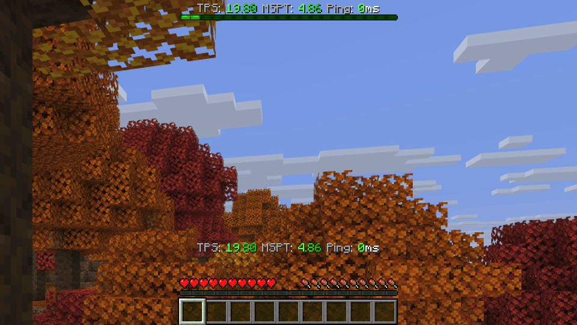

Shows TPS, MSPT and other server stats in the tab list, action bar and boss bar. On Folia every player sees the values of the region they are in, not a server-wide average.

TabTPS Enhanced (formerly TabTPS Folia) started as a Folia fork of [TabTPS by jpenilla](https://github.com/jpenilla/TabTPS). Since 1.2.0 it also runs on Canvas, Paper, Purpur, Leaf and Spigot, and since 1.3.0 as a Forge mod.

Download: [Modrinth](https://modrinth.com/plugin/tabtps-folia) or [GitHub releases](https://github.com/MCbabel/TabTPS-Folia/releases)

Website and documentation: [tabtps.mcbabel.de](https://tabtps.mcbabel.de/) ([docs](https://tabtps.mcbabel.de/docs))

## Platforms

### Plugin

One jar for all of these servers, requires **Java 17+** and Minecraft **1.20 – 26.3**:

| Server | Tick data | Tested on |
|---|---|---|
| [Folia](https://papermc.io/software/folia) | per region | 1.20.1, 1.20.2, 1.20.4, 1.20.6, 1.21.4, 1.21.5, 1.21.6, 1.21.8, 1.21.11, 26.1.2, 26.2, 26.3 |
| [Canvas](https://canvasmc.io) (Folia fork) | per region | 26.3 |
| [Paper](https://papermc.io/software/paper) | global | 1.20.1, 26.3 |
| [Purpur](https://purpurmc.org) | global | 1.20.1, 1.21.4, 1.21.10, 26.3 |
| [Leaf](https://www.leafmc.one) | global | 1.21.4, 26.3 |
| [Spigot](https://www.spigotmc.org) | global | 1.20.1, 1.21.1, 1.21.4, 26.3 |

The plugin detects at startup whether the server ticks regions and picks its tick data source accordingly. Spigot has no Paper API, so there the global TPS/MSPT are read directly from the server.

### Forge mod

A Forge mod needs one jar per Minecraft version:

| Minecraft | Forge | Java | Tested on |
|---|---|---|---|
| 26.3 | 66+ | 25 | dedicated server, singleplayer |
| 1.20.1 | 47+ | 17 | dedicated server, singleplayer |

Put the jar into the `mods/` folder. It only runs on the server side: players do not need it to join a server, and in singleplayer it runs on the built-in server. The config lives in `config/tabtps/`. Permissions go through Forge's permission API, so permission mods that hook into it (for example LuckPerms) can grant them; without one, the display and command permissions default to operators. In singleplayer the world owner always has every permission, so the displays work without cheats.

### Velocity

An optional Velocity plugin shows the TPS, MSPT and player counts of all backend servers on the proxy with `/networktps` (alias `/ntps`, permission `tabtps.network`). It runs on Velocity 3.4 and newer.

1. Put `tabtps-velocity-*.jar` into the proxy's `plugins/` folder.
2. On every backend server that runs the TabTPS plugin, set `send-stats-to-proxy=true` in `main.conf` and run `/tabtps reload`.

The backends send their values every 5 seconds through a player connection, so a server without players shows its last known values with their age, or `no data`. Forge servers do not send data yet. Messages on that channel that come from a client instead of a backend server are dropped.

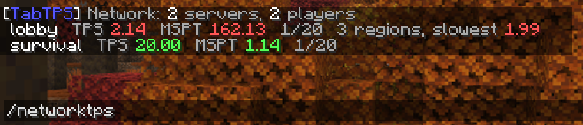

## Features

### Regional TPS/MSPT

On Folia, each player sees the TPS and MSPT of **their current region**, not a global average. When a player moves between regions, the displayed values update automatically.

On servers without regions (Paper, Purpur, Leaf, Spigot) there is a single global tick loop, so `tps` and `mspt` show the server-wide values. Modules that cannot work on a server, like the region modules without regions, are left out of the displays and are not offered in the settings menu.

### Modules

These modules can be used in display configs:

| Module | Description | Without regions |
|---|---|---|
| `tps` | TPS of the player's current region | global TPS |
| `mspt` | MSPT of the player's current region | global MSPT |
| `lowest_region_tps` | Lowest TPS across all active regions | left out |
| `median_region_tps` | Median TPS across all active regions | left out |
| `highest_region_tps` | Highest TPS across all active regions | left out |
| `ping` | Player ping | same |
| `cpu` | CPU usage | same |
| `memory` | Memory usage | same |
| `players` | Online player count | same |
| `uptime` | Time since the server started, e.g. `14:15:16` or `4d 14:15:16` | same |
| `mob_caps` | Mob cap usage of the player's world for every category | left out on Folia and Canvas |
| `mob_cap_<category>` | One category, e.g. `mob_cap_monster`, `mob_cap_creature` | left out on Folia and Canvas |

Mob cap categories: `monster`, `creature`, `ambient`, `axolotls`, `underground_water_creature`, `water_creature`, `water_ambient`. On Forge the values come straight from Minecraft's spawner, on Paper, Purpur, Leaf and Spigot they are counted once a second from the server's entities and the chunks around players. Folia ticks mob caps per region and does not allow counting a whole world, so there the mob cap modules are left out.

### Live Information Displays

#### Tab menu
* Command: ``/tabtps toggle tab``
* 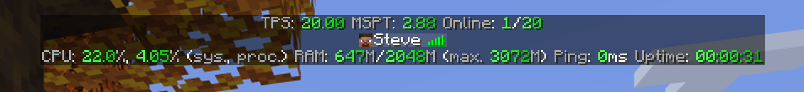

#### Action bar
* Command: ``/tabtps toggle actionbar``
* 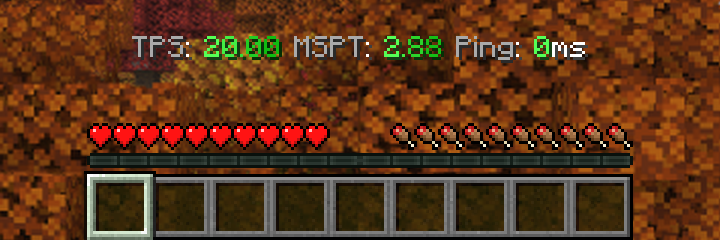

#### Boss bar
* Command: ``/tabtps toggle bossbar``
* 
* Under load it changes color and fills up: 

Configure display modules and themes in `plugins/TabTPS/display-configs/` and `plugins/TabTPS/themes/` (`config/tabtps/` on Forge).

### Optional settings

Everything below is off by default; without changing a config TabTPS behaves exactly like before.

#### Custom text
Each display has a `format` (tab list: `header-format` and `footer-format`) that replaces its module list with your own [MiniMessage](https://docs.advntr.dev/minimessage/format.html) text. Module names work as tags for their value, `<name_label>` gives the translated label:
```hocon
format="<gray>The server runs at <tps> TPS, your ping is <ping>, up for <uptime>"
footer-format="<tps_label>: <tps> <dark_gray>| <gray><mob_caps_label>: <mob_cap_monster>"
```

#### More color levels
Themes take optional `tps-levels` and `mspt-levels`, the boss bar takes optional `levels` by fill percent:
```hocon
tps-levels=[{threshold=19.5, color=green, secondary-color=dark_green}, {threshold=17, color=yellow, secondary-color=gold}, {threshold=0, color=dark_red, secondary-color=red}]
levels=[{percent=0, color=BLUE}, {percent=30, color=GREEN}, {percent=60, color=YELLOW}, {percent=90, color=RED}]
```
The boss bar also follows `/tick rate` on servers that support it, so a full bar always means the target tick time.

#### Boss bar delay
`login-delay-seconds` in the boss bar settings waits that many seconds after a player joins before the boss bar appears, e.g. so boss bars of other plugins come first.

#### Plain console output
`console-colors=false` in `main.conf` turns off colors and gradients for command output in the server console. In the console `/memory` also prints the used, allocated and maximum memory behind each bar.

#### Lag alerts
Set `enabled=true` in the `lag-alerts` section of `main.conf` to get a warning when the server lags for a while. Players with `tabtps.lagalert` (operators by default) get a chat message, the console gets a log line, and a Discord webhook can get a message too:
```hocon
lag-alerts {
    enabled=true
    tps-below=15.0
    mspt-above=0
    seconds=30
    cooldown-seconds=300
    notify-recovery=true
    discord-webhook=""
}
```
`tps-below` and `mspt-above` set the limits, 0 turns that check off. The server has to stay past a limit for `seconds` before an alert goes out, and after an alert the next one waits at least `cooldown-seconds`. On Folia and Canvas the slowest region counts for the TPS check and the busiest region for the MSPT check. The alert names the busiest region, because regions share their tick threads: when one region is overloaded, the TPS of the others drop too, so the region with the lowest TPS is often not the cause.

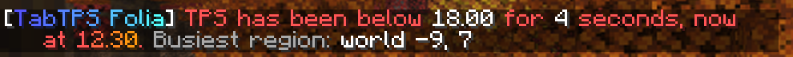

### Settings menu

`/tabtps gui` opens a menu that changes the settings right in the game: the displays with their modules, theme and custom text, the lag alerts, the general options and your own displays. Everything is written to the config files and reloaded right away. Permission `tabtps.gui` (operators by default).

On Minecraft 1.21.6 and newer it uses Minecraft's dialog screens, on older versions a chest menu. The same goes for the Forge mod: dialogs on 26.3, a chest menu on 1.20.1. `gui-style` in `main.conf` can force one of them (`auto`, `dialog` or `chest`). Text values like the Discord webhook are typed in a text field in the dialog, or in chat when using the chest menu. A Discord webhook that is already set shows as `(hidden)`, so its token is not visible in the game; leaving it like that keeps the saved URL.

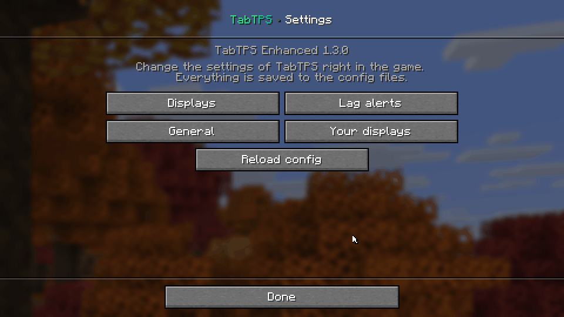

| Dialog (1.21.6+) | Chest menu |
|---|---|
| 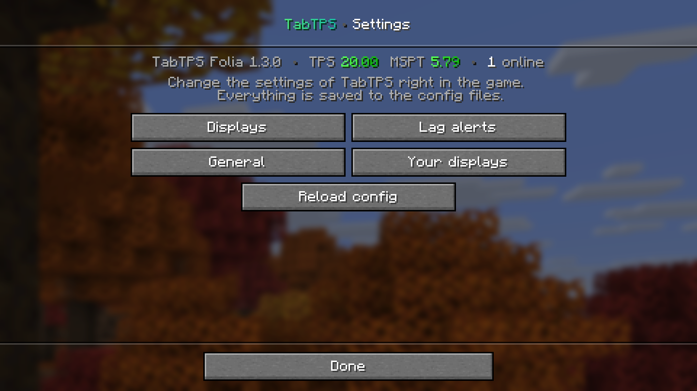 | 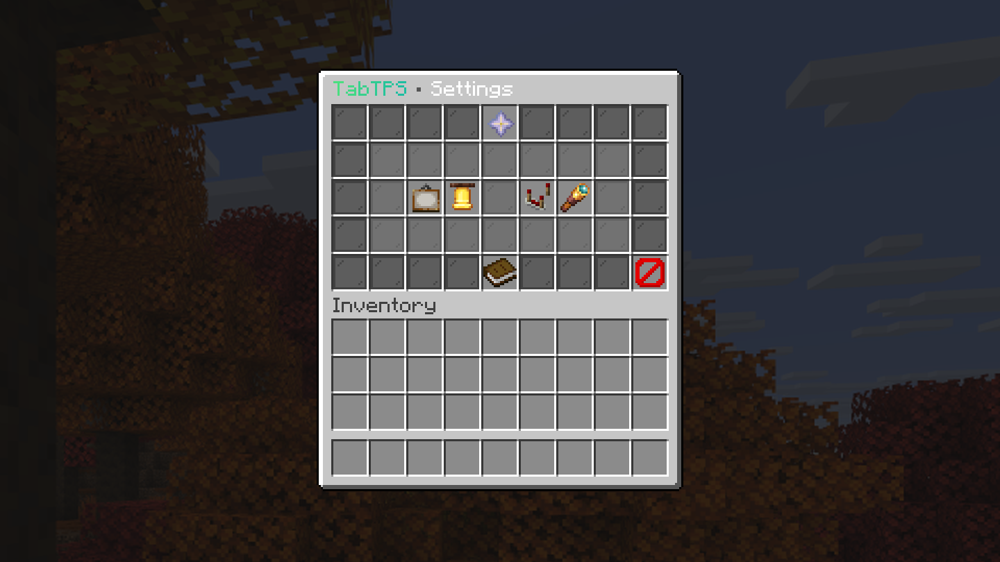 |

### PlaceholderAPI

If [PlaceholderAPI](https://modrinth.com/plugin/placeholderapi) is installed, TabTPS registers these placeholders by itself (plugin only, not Forge):

| Placeholder | Value |
|---|---|
| `%tabtps_tps%`, `%tabtps_tps_5s%`, `_1m`, `_5m`, `_15m` | TPS (of the player's region on Folia) |
| `%tabtps_mspt%` | MSPT (of the player's region on Folia) |
| `%tabtps_ping%` | Player ping |
| `%tabtps_players%`, `%tabtps_max_players%` | Player count |
| `%tabtps_uptime%` | Server uptime |
| `%tabtps_lowest_region_tps%`, `%tabtps_median_region_tps%`, `%tabtps_highest_region_tps%` | Region TPS on Folia, `N/A` elsewhere |
| `%tabtps_cpu_system%`, `%tabtps_cpu_process%` | CPU usage in percent |
| `%tabtps_memory_used%`, `%tabtps_memory_allocated%`, `%tabtps_memory_max%` | Memory in MB |

Add `_colored` to `tps`, `mspt`, `ping` and the region placeholders to get TabTPS' colors, e.g. `%tabtps_tps_colored%`.

### MiniPlaceholders

If [MiniPlaceholders](https://modrinth.com/plugin/miniplaceholders) 2.x or 3.x is installed, the same values are available as MiniMessage tags (plugin only): `<tabtps_tps>`, `<tabtps_mspt>`, `<tabtps_ping>`, `<tabtps_uptime>` and so on, with the same names as the PlaceholderAPI list above. `_colored` works here too, e.g. `<tabtps_tps_colored>`.

### Commands

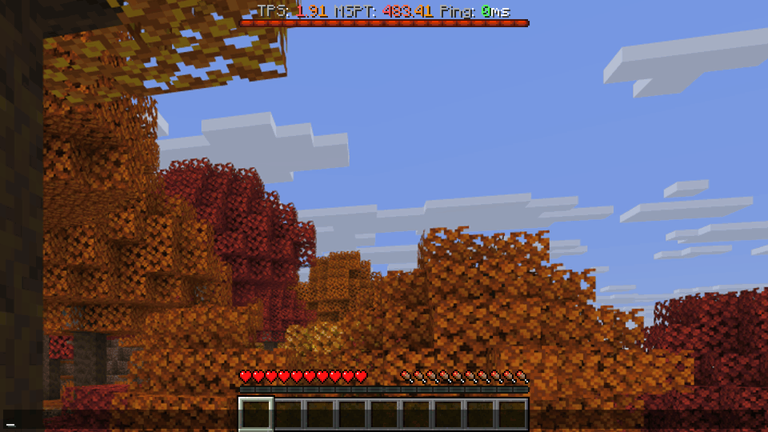

#### Tick Info command
* Command: ``/tickinfo`` or ``/mspt`` (on Paper-based servers ``/mspt`` is Paper's own command)
* On Folia and Canvas: region TPS overview (Lowest/Median/Highest). Without regions: the standard tick time breakdown
* Permission required: ``tabtps.tps``
* 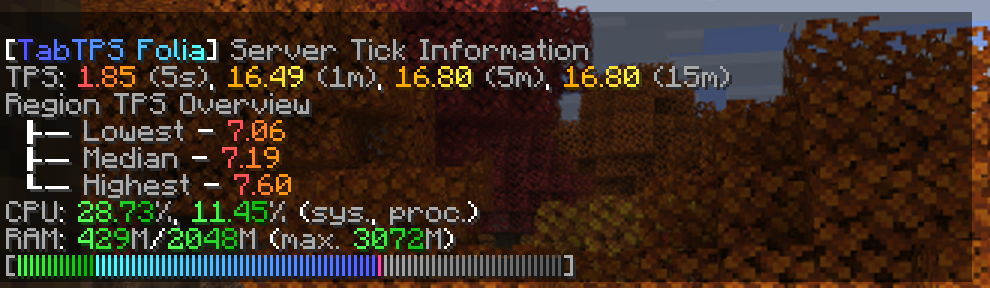

#### Memory command
* Command: ``/memory``, `/mem`, or ``/ram``
* Permission required: ``tabtps.tps``
* 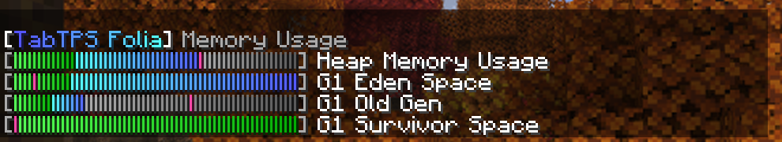

#### Ping command
* Commands: ``/ping``, `/ping [username]`, or ``/pingall``
* Permissions: ``tabtps.ping`` to view your own ping, ``tabtps.ping.others`` to view other users ping.

#### Toggle commands
* Commands: ``/tabtps toggle tab``, ``/tabtps toggle actionbar``, ``/tabtps toggle bossbar``, each optionally with a player name, e.g. ``/tabtps toggle bossbar Steve``
* Permission ``tabtps.toggle.others`` is needed to toggle displays of other players
* Works with ``/execute as <player> run tabtps toggle ...`` from command blocks, the console or data packs; the permissions of whoever runs the command count

#### Mob caps command
* Command: ``/tabtps mobcaps``
* Lists the mob caps of every world and category
* Permission required: ``tabtps.mobcaps``

#### Regions command
* Command: ``/tabtps regions [count]``, only on Folia and Canvas
* Lists the regions with the highest load (10 by default), with world, center, TPS, MSPT, utilisation and their chunk, player and entity counts
* Click a line to teleport to the center of that region, which needs ``tabtps.regions.teleport``
* Permission required: ``tabtps.regions``
* 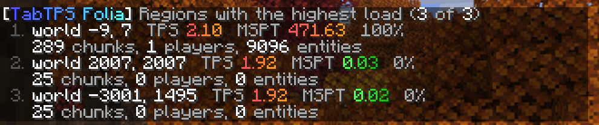

#### Settings menu command
* Command: ``/tabtps gui``
* Opens the settings menu, see [Settings menu](#settings-menu)
* Permission required: ``tabtps.gui``, reloading from the menu also needs ``tabtps.reload``

#### Reload command
* Command: ``/tabtps reload``
* Permission required: ``tabtps.reload``

### Metrics

The plugin sends anonymous usage statistics to [bStats](https://bstats.org). Server owners can turn this off in `plugins/bStats/config.yml`.

### Update checker

On startup TabTPS asks Modrinth once whether a newer version exists for your platform and Minecraft version. If there is one, it prints a hint in the console, and players with the `tabtps.updatenotify` permission (operators by default) get a short chat message with a download link when they join. `update-notify-on-join=false` in `main.conf` turns off the chat message, `update-checker=false` turns off the whole check.

## Building

```bash
./gradlew :tabtps-folia:shadowJar
```

The built JAR will be at `folia/build/libs/tabtps-folia-*.jar`.

The Forge mods build with `./gradlew :tabtps-forge-26-3:build` and `./gradlew :tabtps-forge-1-20-1:build` and end up in `forge/<version>/build/libs/tabtps-forge-mc<version>-*.jar`. For 1.20.1 that jar is renamed to Forge's runtime (SRG) names; the `-mojmap` jar next to it is only for Forge's development client.

The Velocity plugin builds with `./gradlew :tabtps-velocity:build` into `velocity/build/libs/tabtps-velocity-*.jar`. It does not depend on the other modules; the backend plugin and the proxy only share the `tabtps:stats` plugin message format: a protocol byte (1), TPS and MSPT as doubles, online and maximum players as ints, the number of regions as int and the lowest region TPS as double (both -1 without regions), the uptime in seconds as long and the server software as a UTF string.

The settings menu is built once in `common` and handed to the platform either as dialog JSON or as an abstract chest menu. Folia does not register the vanilla `/dialog` command, so on Paper and Folia the plugin parses the dialog with Minecraft's own codec and sends the show-dialog packet through reflection; on Spigot it falls back to `/dialog show`. Saving goes through `/tabtps gui apply`, filled in by the dialog's `dynamic/run_command` action, because a registered command passes the client's check for commands sent from dialogs without a confirmation screen.

MiniPlaceholders works with the server's own Adventure classes, while the plugin ships a relocated copy of Adventure. The hook therefore goes through reflection and a proxy for MiniPlaceholders' resolver interface, and hands the values over as MiniMessage text.

### Notes on the build

The plugin compiles against the **oldest** supported API, `folia-api` 1.20.1, and targets Java 17,
so one jar runs on every server from 1.20 to 26.3. Newer Folia internals are only reached through
reflection, and the reflection goes through names that are the same on every version: Bukkit worlds,
`CraftWorld#getHandle` and Folia's own `io.papermc.paper.threadedregions` classes. That matters
because Folia up to 1.20.4 runs with obfuscated Spigot names, and the CraftBukkit package carries a
version suffix there. `com.mojang:brigadier` is a separate compile-only dependency because the
1.20.1 API does not ship it yet.

The plugin shades and relocates its own Adventure 4, because neither `adventure-platform-bukkit`
(4.4.1 is the newest) nor `cloud-minecraft-extras` (2.0.1) has an Adventure 5 release yet, while
Folia moved to Adventure 5 in 26.2. That is why `net.kyori` and `org.slf4j` are excluded from the
`folia-api` dependency: every library that `shadowJar` relocates has to be compiled against the
exact version that gets bundled. Compiling against a 26.2+ API does not work for the same reason,
because `Player` there extends Adventure 5 types such as `ObjectContentsLike`. Revisit this once
`adventure-platform-bukkit` and `cloud-minecraft-extras` ship Adventure 5 builds.

### Testing

`testservers/test.sh` starts real servers with the built jar, runs the TabTPS console commands and prints one result line per server. It downloads each server from `testservers/servers.txt` (Spigot through BuildTools), keeps only the log in `testservers/logs/` and deletes the server afterwards.

```bash
testservers/test.sh folia-26.3 purpur-1.21.10
testservers/test.sh all
```

`forge-*` entries install the server with the Forge installer and put the mod into `mods/`. `testservers/forge-client` starts Forge's development client straight into a singleplayer world, for example `./gradlew -p testservers/forge-client runClient`, or with `-PforgeVersion=1.20.1-47.4.28 -PjavaVersion=17 -Pmappings=1.20.1` for 1.20.1. It loads whatever jar is in `testservers/forge-client/run/<forge version>/mods/` and expects a world called `tabtps-test` in `saves/`.

Release jars are built on GitHub, not locally. Publish a GitHub release with notes only and no files: `.github/workflows/modrinth.yml` builds the jars, attaches them to the release and uploads the same jars to Modrinth.

## Credits

- Original [TabTPS](https://github.com/jpenilla/TabTPS) by [jpenilla](https://github.com/jpenilla) (MIT License)
- Folia support by [MCbabel](https://github.com/MCbabel)

## License

[MIT License](license.txt) — Copyright (c) 2020-2024 Jason Penilla, Copyright (c) 2026 MCbabel
