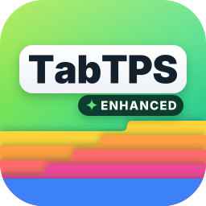

# TabTPS-Folia

Shows TPS, MSPT and other server stats in the tab list, action bar and boss bar. On Folia every player sees the values of the region they are in, not a server-wide average.

Started as a Folia fork of [TabTPS by jpenilla](https://github.com/jpenilla/TabTPS). Since 1.2.0 it also runs on Canvas, Purpur, Leaf and Spigot, and as a Forge mod.

Download: [Modrinth](https://modrinth.com/plugin/tabtps-folia) or [GitHub releases](https://github.com/MCbabel/TabTPS-Folia/releases)

## Platforms

### Plugin

One jar for all of these servers, requires **Java 17+** and Minecraft **1.20 – 26.3**:

| Server | Tick data | Tested on |
|---|---|---|
| [Folia](https://papermc.io/software/folia) | per region | 1.20.1, 1.20.2, 1.20.4, 1.20.6, 1.21.4, 1.21.5, 1.21.6, 1.21.8, 1.21.11, 26.1.2, 26.2, 26.3 |
| [Canvas](https://canvasmc.io) (Folia fork) | per region | 26.3 |
| [Purpur](https://purpurmc.org) | global | 1.20.1, 1.21.4, 1.21.10, 26.3 |
| [Leaf](https://www.leafmc.one) | global | 1.21.4, 26.3 |
| [Spigot](https://www.spigotmc.org) | global | 1.20.1, 1.21.1, 1.21.4, 26.3 |

The plugin detects at startup whether the server ticks regions and picks its tick data source accordingly. Spigot has no Paper API, so there the global TPS/MSPT are read directly from the server.

### Forge mod

A Forge mod needs one jar per Minecraft version:

| Minecraft | Forge | Java | Tested on |
|---|---|---|---|
| 26.3 | 66+ | 25 | dedicated server, singleplayer |
| 1.20.1 | 47+ | 17 | dedicated server, singleplayer |

Put the jar into the `mods/` folder. It only runs on the server side: players do not need it to join a server, and in singleplayer it runs on the built-in server. The config lives in `config/tabtps/`. Permissions go through Forge's permission API, so permission mods that hook into it (for example LuckPerms) can grant them; without one, the display and command permissions default to operators. In singleplayer the world owner always has every permission, so the displays work without cheats.

## Features

### Regional TPS/MSPT

On Folia, each player sees the TPS and MSPT of **their current region**, not a global average. When a player moves between regions, the displayed values update automatically.

On servers without regions (Purpur, Leaf, Spigot) there is a single global tick loop, so `tps` and `mspt` show the server-wide values and the region modules below report `N/A`.

### Modules

These modules can be used in display configs:

| Module | Description | Without regions |
|---|---|---|
| `tps` | TPS of the player's current region | global TPS |
| `mspt` | MSPT of the player's current region | global MSPT |
| `lowest_region_tps` | Lowest TPS across all active regions | `N/A` |
| `median_region_tps` | Median TPS across all active regions | `N/A` |
| `highest_region_tps` | Highest TPS across all active regions | `N/A` |
| `ping` | Player ping | same |
| `cpu` | CPU usage | same |
| `memory` | Memory usage | same |
| `players` | Online player count | same |

### Live Information Displays

#### Tab menu
* Command: ``/tabtps toggle tab``
* 

#### Action bar
* Command: ``/tabtps toggle actionbar``
* 

#### Boss bar
* Command: ``/tabtps toggle bossbar``
* 

Configure display modules and themes in `plugins/TabTPS/display-configs/` and `plugins/TabTPS/themes/`.

### Commands

#### Tick Info command
* Command: ``/tickinfo`` or ``/mspt`` (on Paper-based servers ``/mspt`` is Paper's own command)
* On Folia and Canvas: region TPS overview (Lowest/Median/Highest). Without regions: the standard tick time breakdown
* Permission required: ``tabtps.tps``
* 

#### Memory command
* Command: ``/memory``, `/mem`, or ``/ram``
* Permission required: ``tabtps.tps``
* 

#### Ping command
* Commands: ``/ping``, `/ping [username]`, or ``/pingall``
* Permissions: ``tabtps.ping`` to view your own ping, ``tabtps.ping.others`` to view other users ping.
* 
* 

#### Reload command
* Command: ``/tabtps reload``
* Permission required: ``tabtps.reload``

### Metrics

The plugin sends anonymous usage statistics to [bStats](https://bstats.org). Server owners can turn this off in `plugins/bStats/config.yml`.

## Building

```bash
./gradlew :tabtps-folia:shadowJar
```

The built JAR will be at `folia/build/libs/tabtps-folia-*.jar`.

The Forge mods build with `./gradlew :tabtps-forge-26-3:build` and `./gradlew :tabtps-forge-1-20-1:build` and end up in `forge/<version>/build/libs/tabtps-forge-mc<version>-*.jar`. For 1.20.1 that jar is renamed to Forge's runtime (SRG) names; the `-mojmap` jar next to it is only for Forge's development client.

### Notes on the build

The plugin compiles against the **oldest** supported API, `folia-api` 1.20.1, and targets Java 17,
so one jar runs on every server from 1.20 to 26.3. Newer Folia internals are only reached through
reflection, and the reflection goes through names that are the same on every version: Bukkit worlds,
`CraftWorld#getHandle` and Folia's own `io.papermc.paper.threadedregions` classes. That matters
because Folia up to 1.20.4 runs with obfuscated Spigot names, and the CraftBukkit package carries a
version suffix there. `com.mojang:brigadier` is a separate compile-only dependency because the
1.20.1 API does not ship it yet.

The plugin shades and relocates its own Adventure 4, because neither `adventure-platform-bukkit`
(4.4.1 is the newest) nor `cloud-minecraft-extras` (2.0.1) has an Adventure 5 release yet, while
Folia moved to Adventure 5 in 26.2. That is why `net.kyori` and `org.slf4j` are excluded from the
`folia-api` dependency: every library that `shadowJar` relocates has to be compiled against the
exact version that gets bundled. Compiling against a 26.2+ API does not work for the same reason,
because `Player` there extends Adventure 5 types such as `ObjectContentsLike`. Revisit this once
`adventure-platform-bukkit` and `cloud-minecraft-extras` ship Adventure 5 builds.

### Testing

`testservers/test.sh` starts real servers with the built jar, runs the TabTPS console commands and prints one result line per server. It downloads each server from `testservers/servers.txt` (Spigot through BuildTools), keeps only the log in `testservers/logs/` and deletes the server afterwards.

```bash
testservers/test.sh folia-26.3 purpur-1.21.10
testservers/test.sh all
```

Releases are published to Modrinth by `.github/workflows/modrinth.yml` as soon as a GitHub release is published.

## Credits

- Original [TabTPS](https://github.com/jpenilla/TabTPS) by [jpenilla](https://github.com/jpenilla) (MIT License)
- Folia support by [MCbabel](https://github.com/MCbabel)

## License

[MIT License](license.txt) — Copyright (c) 2020-2024 Jason Penilla, Copyright (c) 2026 MCbabel
